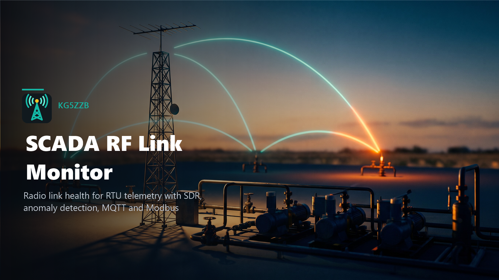
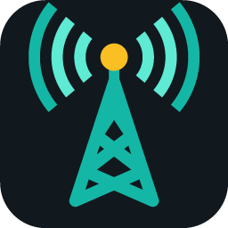

# KG5ZZB - SCADA RF Link Monitor





**Passive health monitoring for SCADA telemetry radio links on Windows: an RTL-SDR listens to the channels your RTUs and PLC radios use, an autoencoder (PyTorch, ONNX Runtime) flags unusual traffic, and link health goes to your SCADA over MQTT and Modbus TCP.**

Pipelines, wellsites, tank farms, water systems and substations often reach their RTUs and PLCs over licensed or unlicensed data radios: a master polls each remote in turn and the remote answers. When a remote radio fails, an antenna gets knocked out of line, or a new noise source shows up near a site, the first sign is usually a communication-failure alarm in the SCADA host. This app watches the radio channel itself, so it can say *why*: the channel went silent, the noise floor rose 9 dB, a third of the polls get no reply, a carrier appeared that should not be there.

It is **receive-only**: it never transmits, so it cannot disturb the radios it watches.

> **Status: v0.1.0.** Channel measurement (DSP), poll/reply tracking, plain-language rules, autoencoder anomaly detection with "Learn this site", alarm log (JSON Lines + CSV), MQTT publisher, Modbus TCP server and a built-in demo all work. 20 automated tests, all passing.

---

## What it does

### 📡 Watches your telemetry channels
- **Your channels, your band:** type the channels your master and remotes use (name, MHz, width). Example lists cover
  **UHF 450-470 MHz** licensed land-mobile data channels (narrowband 12.5 kHz since the FCC narrowbanding rule),
  **928/952 MHz Multiple Address System (MAS)** point-to-multipoint channels (FCC Part 101), and
  **902-928 MHz ISM** frequency-hopping radios (watched as wide slices). The example frequencies are placeholders.
- **Tuning plan:** channels are grouped into as few tuning positions as possible (about 1.9 MHz each at 2.4 MS/s, kept clear of the dongle's DC spike); the dongle visits each for 0.4 s in turn.
- **DSP per dwell:** Hann-windowed 1024-point FFTs (2.34 kHz bins, 427 µs frames), power summed over each channel's bins, band noise floor from the bins between channels, and a steady-carrier finder for signals that are not on any of your channels.

### 📈 Measures every link, every 2 seconds
For each channel, over the last 20 seconds:
- **Transmissions per minute** (polls + replies) and **duty cycle**.
- **RSSI and SNR** of every transmission, and the **weakest 10%** (the radio most likely to drop out first).
- **Noise floor** and its **rise** against the channel's usual level (a slow minimum tracker, or the learned baseline), plus the band-wide floor to tell **broadband** noise from **in-channel** interference.
- **Unanswered polls:** each transmission is checked for a partner within 90 ms; with P polls and A replies the paired fraction is 2A/(P+A), so the share of polls without a reply can be estimated without decoding the protocol.
- **Rhythm** (variation of the gaps) and **traffic change** against the usual level.

### 🧠 Rules you can read, plus machine learning for what rules miss
- **Plain-language rules:** channel silent, interference (with broadband vs in-channel), channel busy all the time (stuck transmitter or babbling RTU), polls without reply, weak signal, traffic change, unexpected carrier. Each alarm says what was seen and what it may mean.
- **Autoencoder anomaly model:** a `12 -> 24 -> 4 -> 24 -> 12` network trained in PyTorch on healthy polling traffic and exported to ONNX. Traffic it cannot rebuild well is unusual; the features with the largest error become the explanation ("whether polls get answers is lower than normal"). Runs in C# with Microsoft.ML.OnnxRuntime in microseconds.
- **Learn this site** (2 minutes): records each channel's normal noise, band floor and traffic, raises a channel's anomaly limit if its normal traffic scores high, and remembers steady carriers that belong there (so a known spur never alarms).
- An alarm is raised after 2 checks in a row and cleared after 3 clean checks, so a single odd window does not flap.

### 🏭 Talks to your SCADA
- **MQTT** (MQTTnet): retained status (with a last-will "offline"), summary and per-channel state; per-channel metrics; alarm events. JSON payloads, configurable prefix and site ID, optional TLS and login. Publishing runs from a bounded background queue with 3 s timeouts, so a missing broker never blocks the radio.
- **Modbus TCP server** (own implementation, function codes 03, 04, 06, 16): overall status, heartbeat, alarm count, and a 20-register block per channel (status, alarm bits, frequency, traffic, SNR, noise, anomaly score, unanswered polls, time since last heard). Write commands acknowledge alarms or start Learn this site. Ignition or any SCADA master can poll it.
- Topic layout and register map: **[docs/INTEGRATION.md](docs/INTEGRATION.md)**.
- **Alarm log:** every alarm raised or cleared is appended as one JSON line to `%APPDATA%\KG5ZZB-SCADA-RF-Link-Monitor\alarms.jsonl`; **Export alarms** writes CSV.

### 🎬 Try it without hardware
**Try the demo** (or start with `--demo`) runs a pretend SCADA network: five polled channels (three UHF, two MAS-style) with 3-6 RTUs each. At 50 s an interferer appears (band-limited noise on one channel plus an unexpected carrier); at 80 s RTU 3 on "MAS pipeline remotes" stops answering. The demo renders real I/Q samples, so it runs through exactly the same DSP, tracking, model and alarm code as a real dongle.

---

## How the machine learning is built

```
DatasetGen (C#)                       train.py (Python, PyTorch)               App (C#, ONNX Runtime)
simulate polled radio networks   ->   autoencoder on healthy windows only  ->  embedded link_autoencoder.onnx
listen like the app (0.4 s dwells)    limit = 99th percentile (validation)     score + per-feature explanation
measure with the app's tracker        evaluate vs threshold rules              every 2 s per channel
```

- **Data:** a C# dataset generator simulates polled channels (a master polling 2-10 RTUs; poll, reply, turnaround and gap timings; retries; 0-3% normal reply loss; 8-32 dB links with slow fading; 12.5 or 25 kHz channels), listens the way the app does (sharing the dongle with up to four other tuning positions), and measures each 20 s window with the app's own `ChannelTracker`. Training uses healthy windows only; the test set adds seven fault types: broadband interference, in-channel interference, a steady carrier, one RTU silent, the whole channel silent, a fading link and a babbling RTU.
- **Fast and faithful:** windows are generated at the FFT-frame level (thousands per minute). A unit test runs the same scenarios through full I/Q rendering, 8-bit quantisation and the real FFT path and checks that both give the same bursts, SNR and noise rise.
- **Training:** a PyTorch training script: standardisation folded into the graph, MSE reconstruction loss, Adam, early stopping, anomaly limit at the 99th percentile of held-out healthy windows.
- **Results on the held-out test set (11,000 windows, separate seed):**

| Detector | Precision | Recall | F1 | False alarms on healthy windows |
|---|---|---|---|---|
| **Autoencoder** | **0.995** | **0.692** | **0.817** | **0.6%** |
| Threshold rules (baseline) | 0.999 | 0.498 | 0.665 | 0.1% |

ROC AUC of the anomaly score: **0.919**. Detection rate per fault, autoencoder vs threshold rules: broadband interference 100% vs 76%, in-channel interference 97% vs 64%, one RTU silent 30% vs 2%, babbling RTU 47% vs 7%, fading link 11% vs 1%; steady carrier and silent channel 100% for both. The threshold baseline uses the fixed limits an engineer would set by hand (silent channel, noise +6 dB, traffic halved or doubled, channel busy 80%).

The autoencoder's gain is on faults that change the *shape* of traffic without crossing a fixed limit, such as one RTU out of several going quiet or a radio keying up at random. The full per-condition table and the training details are in **[docs/MODEL.md](docs/MODEL.md)** (the model card).

## Architecture

| Layer | What it does |
|---|---|
| Hardware | P/Invoke bindings to librtlsdr, async streaming, retune with stale-buffer discard, USB error retries, driver check |
| Tuning | Channel list parsing, presets, tuning plan (fewest positions, clear of DC) |
| DSP | Hann-windowed FFT, per-channel power series, band floor, steady-carrier finder |
| Tracking | Calibrated noise estimate, burst detection with hysteresis, poll/reply pairing, references, 12-feature window |
| Machine learning | Simulation-based dataset, PyTorch autoencoder, ONNX export, ONNX Runtime inference, explanations |
| Decision | Plain-language rules, anomaly limit, alarm persistence, Learn this site |
| Engine | Dwell loop on its own thread, 2 s checks |
| Integration | MQTT publisher, Modbus TCP server and register map, JSON Lines / CSV alarm log |
| Simulation | Polling networks, interferers, I/Q renderer, frame-level simulator, demo scenario and dongle |
| UI | WPF: status banner, per-channel traffic timeline, spectrum, link table with plain-language explanations, alarm log |

## Recommended hardware

| Item | What to use | Why |
|---|---|---|
| **SDR dongles** | **1** RTL-SDR is enough: the app hops between the configured telemetry channels by itself. | A **2nd dongle** would let one dongle stay on the 450-470 MHz group and the other on the 900 MHz group instead of taking turns. Version 0.1.0 drives one dongle; running two at once is planned. |
| **Antenna** | A **450 MHz** and/or **900 MHz antenna** matching the telemetry radios, or one **wideband discone** (about 25 MHz to 1.3 GHz) covering both. | Mount it high and clear of metal: the receiver should hear the master and the remotes about as well as they hear each other. |
| **Coax** | Short, low-loss coax (for example RG-6 or LMR-240 class) between antenna and dongle. | At UHF and 900 MHz long thin coax loses a lot of signal. |
| **Optional** | A band-pass filter or LNA for the band you watch. | Helps near strong transmitters (broadcast, cellular, paging) that can overload the dongle. |

## Requirements
- Windows 10 or 11, 64-bit.
- An RTL-SDR dongle (RTL2832U + R820T/R828D tuner) with the WinUSB driver (install once with [Zadig](https://zadig.akeo.ie/)). Works with the Nooelec NESDR SMArt v5 and other RTL2832U dongles.
- An antenna for the band you watch.
- Optional: an MQTT broker, or a SCADA system with a Modbus TCP driver.

## Scope
- An RTL-SDR covers about 24 MHz to 1.7 GHz and sees about 2 MHz at a time; channels farther apart share the dongle in turns, so each is heard part of the time.
- Receive-only. The app measures radio activity and does not decode or interact with the SCADA protocol; it never transmits.
- Use of radio receivers and the information they capture is subject to local law; monitor only systems you are authorised to monitor.

## Source code
This repository is the public showcase: description, results, model card and images.
The source code is private. Technical walkthroughs are available on request.

## License
Copyright (c) 2026 KG5ZZB. All rights reserved. Text and images may not be reused without permission.
